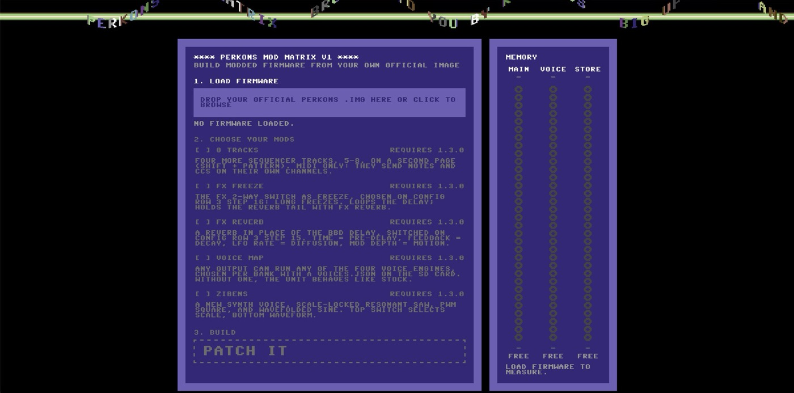

# perkons-re

Reverse-engineering and modding framework for the **Erica Synths Pērkons HD-01** firmware:
unpack/repack update images, analyse both cores in Ghidra, run the real firmware code in
an emulator, and build patched firmware (byte patches or C code) with automatic
regression checks against stock.

> Unofficial. Not affiliated with Erica Synths. Flashing modified firmware is at your
> own risk; read [Get modded firmware](#get-modded-firmware) first (flashing and going back
> to the official firmware).
> No firmware binaries are distributed here: bring the official update files.

**Just want modded firmware for your Pērkons?** Follow [Get modded firmware](#get-modded-firmware)
below. No programming needed, and no firmware files come from here: you build your own
from the official update.

## Get modded firmware

You pick the mods you want in the **Mod Matrix**, a small app that runs in your browser,
on your own computer. It patches the official firmware you downloaded from Erica Synths
and gives you a new firmware file to flash. Nothing is uploaded anywhere.



### What you need

* The official Pērkons firmware **1.3.0** from Erica Synths (the file is called
  `perkons_v1.3.0-0-force.img`).
* The Pērkons's SD card and a way to read it on your computer.
* A Mac, Linux or Windows computer.

### 1. Install three programs (once)

| | macOS | Linux (Debian/Ubuntu) | Windows |
|---|---|---|---|
| **git** | `xcode-select --install` | `sudo apt install git` | [git-scm.com](https://git-scm.com/) |
| **Python 3.9 or newer** | comes with the line above | `sudo apt install python3 python3-venv` | [python.org](https://www.python.org/downloads/): tick "Add python.exe to PATH" |
| **Arm GCC** (builds the mods) | `brew install arm-none-eabi-gcc arm-none-eabi-binutils` ([Homebrew](https://brew.sh)) | `sudo apt install gcc-arm-none-eabi binutils-arm-none-eabi` | [Arm GNU Toolchain](https://developer.arm.com/downloads/-/arm-gnu-toolchain-downloads), the `arm-none-eabi` installer: tick "Add path to environment variable" |

Type the commands into a terminal (macOS: Terminal; Linux: any terminal; Windows: use the
installers, then open a new Command Prompt).

### 2. Download this project (once)

```sh
git clone https://github.com/kiteless/perkons-re
cd perkons-re
```

### 3. Start the Mod Matrix

macOS / Linux:

```sh
python3 start_modmatrix.py
```

Windows:

```bat
py start_modmatrix.py
```

The first time, this sets things up for you: a private Python environment inside the
`perkons-re` folder, and the mods, downloaded next to it into `perkons-re-mods`. Then
the Mod Matrix opens in your browser at http://127.0.0.1:6464/. If something is
missing, the script says what to install. To stop it, press Ctrl-C in the terminal.
Next time, just run step 3 again (in the `perkons-re` folder).

### 4. Build your firmware

1. Drop the official `perkons_v1.3.0-0-force.img` on the page (or click to choose it). It
   only accepts an unmodified official image.
2. Tick the mods you want. Some need another mod; the page ticks it for you.
3. Press **PATCH IT** and wait about a minute.
4. Press **DOWNLOAD**. You get a new `perkons_v1.3.0-0-force.img`.

### 5. Flash it

1. Copy the new `perkons_v1.3.0-0-force.img` to the **root of the SD card**. It must have
   exactly that name and be the only `.img` file there: replace any old one (on a Mac, if
   Finder asks, choose **Replace**, not "Keep Both").
2. Put the card in the Pērkons. Power off, **hold all four voice trigger keys**, and power
   on. Let go when the first row of steps starts lighting; rows light 1 → 3 → 2 → 4, then
   the Pērkons starts.
3. Check it worked: `INFO.TXT` on the card now shows a tag after the version, e.g.
   `1.3.0 - mm-vmsl`. Plain `1.3.0 - gd5b5810` means the official firmware is still on it.

### 6. Use the mods

Each mod's page says how to use it:
[voice-map](https://github.com/kiteless/perkons-re-mods/tree/main/voice-map),
[voice-slinks](https://github.com/kiteless/perkons-re-mods/tree/main/voice-slinks),
[fx-reverb](https://github.com/kiteless/perkons-re-mods/tree/main/fx-reverb),
[fx-freeze](https://github.com/kiteless/perkons-re-mods/tree/main/fx-freeze),
[eight-lanes](https://github.com/kiteless/perkons-re-mods/tree/main/eight-lanes),
[per-track-lfo](https://github.com/kiteless/perkons-re-mods/tree/main/per-track-lfo).

### Going back to the official firmware

Flash the official `perkons_v1.3.0-0-force.img` the same way (step 5). Do this before
any warranty service. If a unit doesn't start after flashing a modified image, flash the
official image the same way: the update mode lives in the unit's bootloader, which no
build touches.

> A firmware file you build contains Erica Synths' firmware: it's for your own Pērkons,
> please don't share it. Modified firmware is used at your own risk.

# For developers

## What's here

| path | |
|---|---|
| `tools/fwtool.py` | inspect / unpack / repack / verify `.img` update files |
| `tools/thumbdis.py`, `tools/xref.py` | Thumb-2 disassembly with literal annotation; find references to an address |
| `tools/render_voices.py` | emulate the M7 DSP and render every stock voice/algo/mode to WAV |
| `tools/build.py` | apply patches → `.img`, then check every output against stock in the emulator |
| `tools/release.py` | versioned release: patches + `version_stamp`, regression, image + `RELEASE.md` with exact commits |
| `tools/check_symbols.py` | behavioural checks of a symbols file (each symbol does what we think, in the emulator) |
| `tools/port_symbols.py` | port symbols to another firmware version: matching + probes + checks + report |
| `tools/run_tests.py` | framework tests + mod tests |
| `start_modmatrix.py` | one-step setup + start of the Mod Matrix (see [Get modded firmware](#get-modded-firmware)) |
| `tools/modmatrix.py`, `ui/modmatrix/` | **Mod Matrix**: pick mods with checkboxes, build modded firmware from your own official image in the browser |
| `tools/perkons/` | library: `fwimage` (container), `emu` (`M7Emu`, `M7System`, `M4Emu` + virtual SD card), `patch` (guarded byte patches), `cbuild` (C → code cave), `verify` (behavioural checks), `mods` (out-of-tree patches), `m4host` (shared M4 plumbing for mods), `catalog` (Mod Matrix options and image checks), `ram` (MAIN / VOICE / STORE areas) |
| `include/m4`, `include/m7` | C headers describing the firmware for patch code |
| `patches/` | `tag_build` (string-only smoke test), `example_hook` (template C patch), `version_stamp` (identify a build in `INFO.TXT` + boot banner), `axi_canary` (test image: reports in `CANARY.TXT` whether the STORE area stays untouched) |
| `symbols/` | per-version functions, globals, struct offsets and named patch sites; the only place addresses live (read by the emulator, C builds, patches and Ghidra) |
| `ghidra/` | headless import + analysis, decompile, and "who references X" query scripts |
| `docs/porting.md` | moving mods to a new official firmware: symbol porter, probes, checks, rehearsal results |
| `docs/writing-mods.md` | making a new mod, step by step |

## Setup

Prerequisites (macOS/Homebrew shown):

| tool | for | install |
|---|---|---|
| Python ≥ 3.9 | all tools | system / `brew install python` |
| Arm GNU GCC | compiling C patch code | `brew install arm-none-eabi-gcc arm-none-eabi-binutils` |
| Ghidra | interactive analysis, decompiler | `brew install ghidra` (brings its own Java) |

```sh
make setup          # .venv with pinned capstone + unicorn
make tools-check    # confirm everything is found
# put the official .img files in the repo root or firmware/ (they're gitignored)
make test           # ~10 s for the framework; skips tests whose firmware image is missing
make help           # everything else
```

## Quick start

```sh
make unpack                                   # firmware/unpacked/v1.3.0/{m4,m7}.bin
make ghidra                                   # analyze both cores (~40 s), then: ghidraRun
ghidra/query.sh v1.3.0 m4 samples 'str:SAMPLES'   # who uses this string? -> pseudo-C
make render                                   # out/stock/*.wav
make build PATCHES=example_hook               # builds/example_hook.img + regression check
```

## Writing a mod

Step by step, from RE to Mod Matrix to hardware: **[docs/writing-mods.md](docs/writing-mods.md)**.
The short version:

Start from `patches/example_hook.py` + `patches/src/m7/example_hook.c`. A patch module
declares `TARGET` (firmware version, or `None` for any), `SUMMARY`, `RISK` and
`apply(p, arg=None)`. Patch by **name**, never by address: `p.redirect_call(core, site,
...)`, `p.replace_with_call`, `p.replace_word`, with sites, offsets and constants from
`symbols/` (C code gets them as `SYM_`/`OFF_`/`CONST_` defines). Every write states the
bytes it expects to replace, so a patch can't apply to the wrong firmware, and a mod
written this way ports to a new firmware by porting its symbols (docs/porting.md).

Mods can live outside this repo. Point `PERKONS_MODS` at a mod directory (or a directory
of mods), e.g. in an untracked `local.mk`:

```make
PERKONS_MODS = ../my-mods
```

A mod has `patches/` (patch modules), optionally `src/<core>/` (C), `lib/` (Python
helpers) and `tests/` (picked up by `make test`). `make build PATCHES=my_patch:arg` finds
patches in either place. See `tools/perkons/mods.py`.

## Mod Matrix

`python3 start_modmatrix.py` (or `make ui`, `UI_ARGS=--no-intro` to skip the intro) runs
`tools/modmatrix.py`: a Python standard-library server on 127.0.0.1 and a plain
HTML/JS page in `ui/modmatrix/`. It reads only the image's header (version), CRCs and
hash (`symbols/official-images.json`), builds with `tools/build.py`, stamps the build with
`version_stamp` (`mm-<codes>`), and serves the result for download. Options: `--port N`,
`--no-browser`, `--no-intro`.

The **MEMORY** pane shows the RAM mods can use, in three areas: **MAIN** (M4 patch RAM,
64 KB), **VOICE** (M7 RAM, 76 KB) and **STORE** (more M4 RAM, 111 KB). After an image is
loaded it builds each option alone to see what it takes; the meters follow the ticks, and
a mod that wouldn't fit can't be ticked (`tools/perkons/ram.py`).

### Adding a mod to it

Mods appear through a `mod.json` in the mod folder (see `tools/perkons/catalog.py`):
title, summary, the patch specs, a two-letter code for the build tag, and optional
`conflicts` (option ids that can't be combined). Target version and risk come from the
patch modules. Mods without a `mod.json` (and development patches not listed in one)
aren't offered.

## Releases

A release definition (JSON, see `tools/release.py`) names the base firmware, the patches
and a version tag. `make release REL=path/to/release.json` builds it with
`version_stamp`, runs the regression and writes `builds/releases/<name>-<version>/` with
the image (official file name) and a `RELEASE.md` recording the base firmware and the
exact commits used. A stamped unit shows the tag in `INFO.TXT` on its SD card
(`… version: 1.3.0 - <tag>`).

## License

MIT, see [LICENSE](LICENSE). Covers the code and documentation in this repository only.
